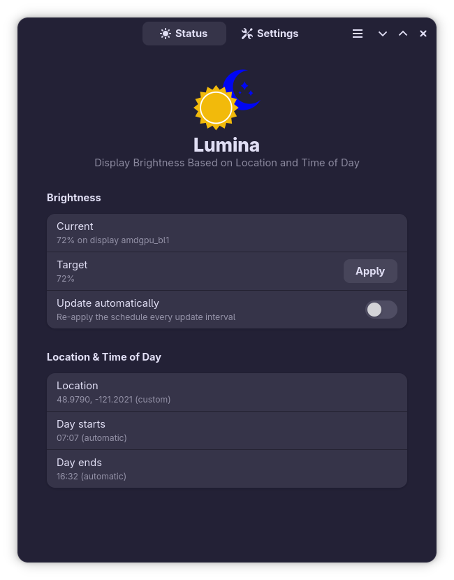
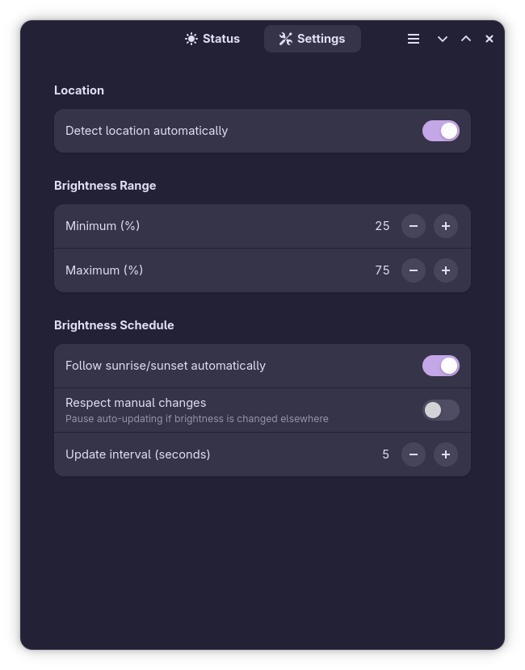
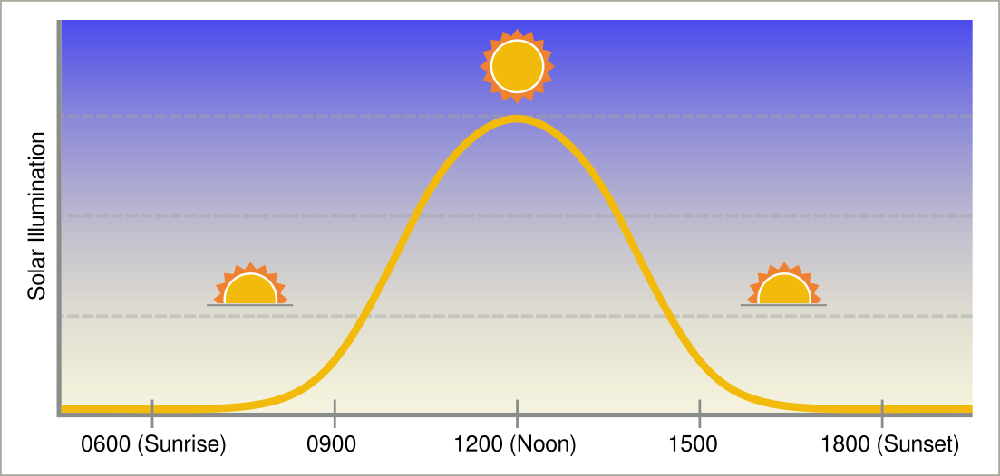

<!-- markdownlint-disable MD033 -->
<!-- markdownlint-disable MD041 -->
<p align="left">

</p>
<!-- markdownlint-enable MD041 -->

<a href="https://github.com/richbl/rust-lumina/releases"></a>
<a href="https://github.com/richbl/rust-lumina/pulls?q=is%3Apr+state%3Aclosed"></a>
<a href="https://app.codacy.com/gh/richbl/rust-lumina/dashboard?utm_source=gh&utm_medium=referral&utm_content=&utm_campaign=Badge_grade"></a>
<!-- <a href="https://sonarcloud.io/summary/new_code?id=richbl_rust-lumina"></a> -->

<!-- <a href="https://codeberg.org/richbl/rust-lumina"></a> -->
<!-- markdownlint-enable MD033 -->

**Lumina** **automatically dims and brightens your device display(s) based on your location and the time of day**

## About

**Lumina** is a Rust-based application designed to automatically manage the screen brightness of device display(s) over the course of the day. It does this by determining your location (via a query to a public website API, or via manual input). Based on your location, the application then creates a "brightness curve" that begins at sunrise, peaks in brightness around mid-day, and then slowly reduces display brightness until sunset.

### Motivation

Why create **Lumina**?

To automate device display brightness over the course of the day.

I'm often in front of a computer most of the day, and in the Pacific Northwest, that usually means "dark when I start my day" and "dark when I end my day." **Lumina** makes my life a bit easier, as I never have to mess with device display brightness controls.

### Lumina In Action

<!-- markdownlint-disable MD033 -->
<p align="center">

</p>

<p align="center">

</p>

<!-- markdownlint-enable MD033 -->

## Features

* **Dual Application Interfaces**
  * Choose between running **Lumina** in a lightweight CLI or via a GTK4/libadwaita graphical user interface (GUI)
* **Automatic Brightness Management**
  * Automatically adjusts display brightness throughout the day
* **Automatic Location Detection**
  * Determines geographic coordinates using IP geolocation services (with a fallback provider and on-disk caching)
  * **Manual Location Override**
    * Supports manually specifying latitude and longitude
* **Location-Aware Scheduling**
  * Automatically uses geographic coordinates to calculate local sunrise and sunset times to follow a "brightness curve", or optionally override these values and use manually-specified start and stop times
* **Smooth Brightness Transitions**
  * Uses a sinusoidal "brightness curve" to provide gradual transitions throughout the day
* **Configurable Brightness Limits**
  * Independently configurable minimum and maximum display brightness values
* **Configurable Update Interval**
  * Controls how frequently **Lumina** evaluates and applies brightness adjustments
* **Manual Brightness Override**
  * Optionally respects brightness changes made outside of **Lumina** (e.g., manual brightness adjustments by the user)
* **Live Configuration Reload**
  * Edits are picked up while **Lumina** is running: no need to restart the application
* **Multi-Display Support**
  * Every controllable display is tracked and updated, with per-device error reporting
* **Integrated Installer**
  * A user-level installer/uninstaller is integrated directly into the **Lumina** application (no root required)

* **Highly Configurable**
  * **Lumina** relies on a TOML-based file to manage the configuration for:
    * Device display(s) brightness min/max values (`%`)
    * Location (latitude/longitude) (`+/- 00.0000000`)
    * Scheduling
      * Start time-of-day (`HH:MM`) — overrides sunrise
      * Stop time-of-day (`HH:MM`) — overrides sunset
      * Brightness update interval (seconds)
      * Respect for manual brightness changes (`true/false`)

## How Lumina Works

**Lumina** determines display brightness based on the natural illumination (solar irradiance) generated by the sun over the course of the day. This pattern is non-linear and follows a sinusoidal, or bell-shaped, "brightness curve" between local sunrise and sunset (the "daytime window").

By computing this "brightness curve" with the location of the device display (latitude/longitude) and the current time of day, **Lumina** is able to apply a smooth brightness progression (or regression in the afternoon hours) that very closely emulates the relative brightness of the sun over the course of the day.

### The Brightness Curve

Brightness follows a smooth half-sine curve across the daytime window. That formula is as follows:

$$B(t)=B\_{\min}+(B\_{\max}-B\_{\min}) \sin\left(\pi\frac{t-t_d}{t_s-t_d}\right)$$

Where:

* $B_{\min}$ = minimum % brightness (user configurable)
* $B_{\max}$ = maximum % brightness (user configurable)
* $t_d$ = daytime start, initially sunrise (user configurable)
* $t_s$ = daytime end, initially sunset (user configurable)
* $t_n$ = solar noon

Thus, the brightness curve sits at `min` at the start of the window, ramps quickly around sunrise, peaks at `max` at the midpoint (solar noon), eases back to `min` as the sun sets, and holds at `min` overnight.

The figure below presents a notional daytime window, starting at 0600 and ending at 1800. The brightness curve follows a half-sine arc and demonstrates how solar irradiance changes non-linearly over the course of the day.

<!-- markdownlint-disable MD033 -->
<p align="center">

</p>
<!-- markdownlint-enable MD033 -->

### Location Detection

In order to accurately calculate the brightness curve for your device display, **Lumina** attempts to determine your computer's approximate location (latitude/longitude) using IP geolocation services.

**Lumina** uses the following location providers, queried in order:

1. [ipwho.is](https://ipwho.is/)
2. [ipapi.co](https://ipapi.co/)

The last successfully determined location is cached locally by **Lumina** for subsequent use.

You can bypass this automatic location detection entirely by disabling the `Detection location automatically` option in the **Lumina** GUI, or by specifying latitude and longitude values directly in the **Lumina** configuration file.

> **Note:** IP-based geolocation provides an approximate location and may not always accurately represent the computer's physical location, particularly when using VPNs, proxies, or geographically distributed internet connections

## Installation

**Lumina** requires a Linux environment with a supported, brightness-controllable display.

To determine if your computer's display can be managed using **Lumina**, run the following commands:

```text
cat /sys/class/backlight/amdgpu_bl1/brightness
cat /sys/class/backlight/amdgpu_bl1/max_brightness
```

These two values determine the current brightness as a percent of maximum display brightness.

**Lumina** calculates current brightness using the formula below:

$$current\ brightness=\left(\frac{brightness}{max\ brightness}\right)\times100$$

As an example, if `brightness=26113` and `max_brightness=65535`, the current brightness value returned (as a percent) would be `40%`.

### Using the Lumina Installer

**Lumina** includes its own installer/uninstaller built directly into the `lumina` binary file. To install **Lumina**, first download the **Lumina** binary files (available in each GitHub release). These binary files are:

* `lumina`: runs in CLI Mode
* `lumina-gui`: runs in GUI Mode

Only the `lumina` binary includes the **Lumina** application installer. If the `lumina` installer finds `lumina-gui` in the same folder, it will automatically install both `lumina` and `lumina-gui`.

To install **Lumina**, run the following command:

```text
lumina install     # or: lumina -i / lumina --install
```

Everything is installed for the current user (no root access needed):

| Item | Location |
| ------ | ---------- |
| `lumina` binary | `~/.local/bin` |
| `lumina-gui` binary (optional) | `~/.local/bin` |
| Desktop entry (`io.github.richbl.Lumina.desktop`) | `~/.local/share/applications` |
| Icon (`io.github.richbl.Lumina.svg`) | `~/.local/share/icons/hicolor/scalable/apps` |

The installer honors `XDG_BIN_HOME` and `XDG_DATA_HOME` if set, and warns if the bin directory is not on your `PATH`.

### Uninstalling Lumina

To remove **Lumina**:

```text
lumina uninstall     # or: lumina -u / lumina --uninstall
```

> **Note:** Your **Lumina** configuration file is intentionally not removed during the uninstallation process. You must manually remove it from `~/.config/lumina/config.toml`.

### Building Lumina from Source

#### Installing Build Dependencies

Building **Lumina** requires:

* Rust 1.95 or later
* Cargo (included with the Rust toolchain)

Building the graphical interface additionally requires:

* GTK4 development libraries
* Libadwaita development libraries (version 1.5 or later)
* `pkg-config`

##### Fedora

```text
sudo dnf install gtk4-devel libadwaita-devel pkgconf-pkg-config
```

##### Debian/Ubuntu

```text
sudo apt install libgtk-4-dev libadwaita-1-dev pkg-config
```

#### Compiling the Lumina Repository

Download, clone the **Lumina** repository, and compile the application:

```text
git clone https://github.com/richbl/rust-lumina.git
cd rust-lumina

# CLI only:
cargo build --release

# CLI + GUI (optional):
cargo build --release --features gui
```

The resulting executables are located in `target/release/`:

```text
target/release/
├── lumina
└── lumina-gui
```

The build of the GUI binary is optional. Users interested in running **Lumina** in CLI Mode exclusively can build for just the CLI.

Once the **Lumina** binaries are built, you can optionally run the test suite and/or Rust linter (`clippy`):

```text
cargo test --all-features
cargo clippy --all-features
```

## Lumina Usage

### CLI Mode

```text
lumina <COMMAND> [OPTIONS]
```

Running `lumina -h` (or `--help`) generates the following:

```text
Lumina 0.1.0

Display Brightness Based on Location and Time of Day

Usage: lumina <COMMAND> [OPTIONS]

Commands:
  get                         Show current brightness of each device display
  set                         Set display brightness (0-100%) immediately
  location                    Show the detected/configured device location
  suntime                     Show today's sunrise and sunset times
  daytime                     Show the day start and end times currently in use
  status                      Show the target display brightness
  apply                       Apply the target brightness once and exit
  run                         Apply the target brightness until interrupted
  install, -i, --install      Install lumina for the current user (under ~/.local)
  uninstall, -u, --uninstall  Remove the current user's lumina installation
  help                        Print this message or the help of the given subcommand(s)

Options:
  -h, --help  Print help

When running a command (except get/set/install/uninstall), the following flag is available:
  -c, --config <FILE>  Config file (default: $XDG_CONFIG_HOME/lumina/config.toml)
```

Examples:

```text
lumina run                      # actively follow the brightness curve
lumina run -c ~/alt-config.toml # run lumina, but with an alternate config file
lumina status                   # what would the brightness be right now?
lumina set 60                   # set all displays to 60% immediately
lumina suntime                  # today's sunrise/sunset
```

While the `run` command is active:

* Pressing Ctrl+C (`SIGINT`) interrupts the daemon and shuts down **Lumina**

### GUI Mode

**Lumina** also runs as a stand-alone GTK4/libadwaita application:

```text
lumina-gui
```

or launch **Lumina** from your desktop environment's application launcher.

The GUI provides graphical controls for all configuration settings (location, brightness min/max, and scheduling), a live status view, and automatic saving of configuration details to the same configuration file used by **Lumina** when run in CLI Mode.

## Configuration

**Lumina** uses a single, shared [`TOML`](https://toml.io/en/) configuration file when running in either CLI Mode or GUI Mode.

The default configuration location is:

```text
~/.config/lumina/config.toml
```

If `XDG_CONFIG_HOME` is defined, **Lumina** uses:

```text
$XDG_CONFIG_HOME/lumina/config.toml
```

> **Note:** An alternate configuration file can be specified using the application's `--config` command-line option.

### Configuration File Example

```toml
# Lumina Configuration (TOML)
# v0.1.0

[location]
latitude = 47.9789803
longitude = -122.2020794

[brightness]
min = 20
max = 90

[schedule]
start_time = "07:00"
stop_time = "22:00"
interval_seconds = 60
respect_manual_changes = false

```

### Configuration File Options

#### Location

| Option | Description |
| --- | --- |
| `latitude` | Geographic latitude in decimal degrees (-90 to 90) |
| `longitude` | Geographic longitude in decimal degrees (-180 to 180) |

Both coordinates must be specified together. If omitted, **Lumina** uses IP-based geolocation when solar scheduling requires a location.

#### Brightness

| Option | Default | Description |
| --- | ---: | --- |
| `min` | `20` | Minimum display brightness (0–100%) |
| `max` | `90` | Maximum display brightness (0–100%) |

Both values must be between 0 and 100, and the minimum cannot exceed the maximum.

#### Schedule

| Option | Default | Description |
| --- | --- | --- |
| `start_time` | Sunrise | Override the calculated sunrise time |
| `stop_time` | Sunset | Override the calculated sunset time |
| `interval_seconds` | `60` | Interval between brightness updates (1–3600 seconds) |
| `respect_manual_changes` | `false` | Respect brightness changes made outside Lumina instead of continuing to enforce the schedule |

Times use the 24-hour `HH:MM` format and represent local time.

The start and stop times can be independently overridden. If only one is specified, **Lumina** calculates the other using the configured or detected location.

> **Note:** All configuration sections and individual options are optional. Any omitted values are populated by **Lumina** using the application defaults.

## License

**Lumina** is open-source software distributed under the [MIT License](LICENSE).
