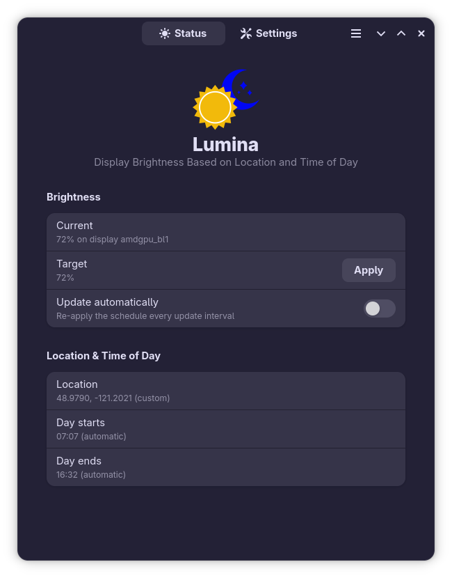
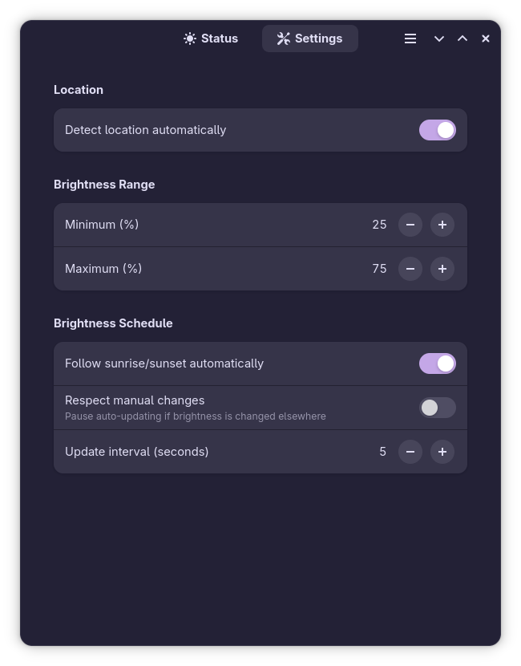
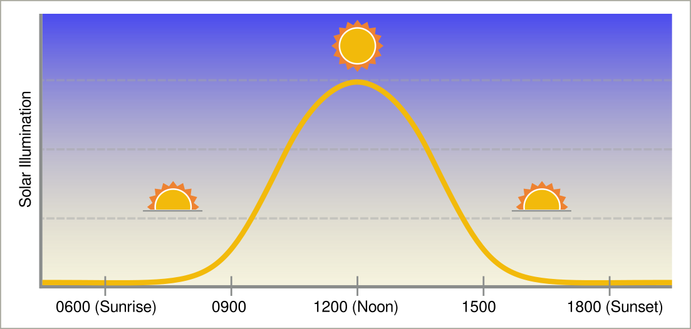

<!-- markdownlint-disable MD033 -->
<!-- markdownlint-disable MD041 -->

<!-- markdownlint-enable MD041 -->

<!--  -->
<!-- markdownlint-enable MD033 -->

Automatically dims/brightens device displays based on location and time of day

## Overview

**Lumina** is a Rust-based application designed to automatically manage the screen brightness of device display(s) over the course of the day. It does this by determining your location (via a query to a public website API, or via manual input). Based on your location, the application then creates a "brightness curve" starting from sunrise, peaking in brightness around mid-day, and then slowly reducing brightness until sunset.

<!-- markdownlint-disable MD033 -->

<!-- markdownlint-enable MD033 -->

## Features

* Choice of **Lumina** running modes:

  * GUI Mode: a modern GTK4/Adwaita design
    * All configuration settings can be made via graphical controls
    * Automated saving of configuration details

  * CLI Mode: a simple command-line interface with minimal operational overhead
    * Application flags for commands and options to override configuration file settings

* Highly configurable TOML-based configuration files for:
  * Device display(s) brightness min/max values (`%`)
  * Location (latitude/longitude) (`+/- 00.0000000`)
  * Scheduling
    * Start time-of-day (`HH:MM`)
    * Stop time-of-day (`HH:MM`)
    * Brightness update interval (seconds)
    * Manual schedule override (`true/false`)

* Graceful handling of connection interrupts and system signals for a clean shutdown

* Integrated application installer/uninstaller for easy setup and self-removal of the application

## Rationale

Why build **Lumina**? To automate device brightness. I'm often in front of a computer over the course of the day, and in the Pacific Northwest, that usually means "dark when I start my day" and "dark when I end my day." So, **Lumina** makes my life just a bit easier so I don't have to mess with brightness controls on a daily basis.

## How Brightness Works

Brightness follows a smooth half-sine curve across a "daytime window" (sunrise to sunset unless overridden): `min` at the start, peak `max` at the midpoint, back to `min` at the stop, and `min` overnight.

<!-- markdownlint-disable MD033 -->

<!-- markdownlint-enable MD033 -->

## Configuration

Regardless whether you're running **Lumina** in CLI Mode or GUI Mode, the application creates a default configuration file in `~/.config/lumina/config.toml`:

    # Lumina Configuration (TOML)
    # v0.1.0

    [location]
    latitude = 47.9789803
    longitude = -122.2020794

    [brightness]
    min = 25
    max = 75

    [schedule]
    start_time = "07:08"
    stop_time = "16:39"
    interval_seconds = 5
    respect_manual_changes = true

Note that all sections and keys are optional, and command line flags override these options on a per-session basis.

## The Lumina GUI Application

In addition to running via the command line, `Lumina` can run as a stand-alone GUI application based on GTK4/Libadwaita using the Relm4 crate.

## Building the **Lumina** Application

If you plan to compile/build `Lumina` on your machine, you'll need the following packages:

* Debian/Ubuntu build dependencies (libadwaita >= 1.4 required):

      sudo apt install libgtk-4-dev libadwaita-1-dev pkg-config

* Fedora build dependencies:

      sudo dnf install gtk4-devel libadwaita-devel
